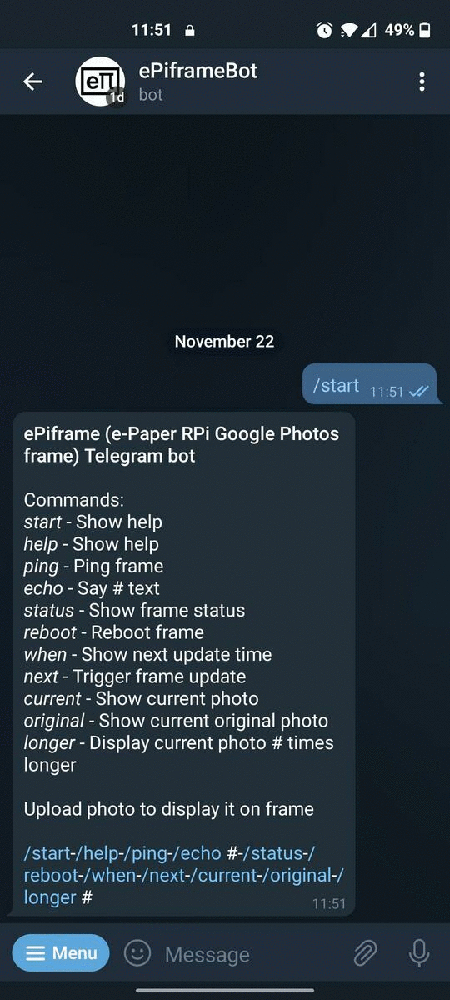
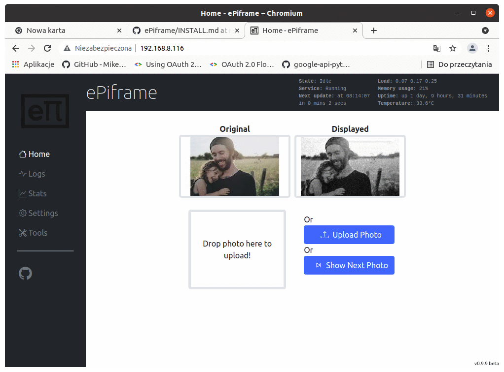

# ePiframe Documentation

## Table of Contents
<!--ts-->
   * [Installation](#installation)
      * [Automatic](#automatic)
      * [Manual](#manual)
      * [Next steps](#next-steps)
	  	* [Local Source](#local-source)
			* [Cloud sync](#cloud-sync)
			* [Other sources](#other-sources)
			* [Pre-process photos](#pre-process-photos)
	  	* [Google Drive Source](#google-drive-source)
      	* [Weather Stamp](#weather-stamp)
      	* [Telegram Bot](#telegram-bot)
      	* [Web User Interface](#web-user-interface)
			* [WebUI Users](#webui-users)
			* [API](#api)
      	* [Plugins](#plugins)
			* [Plugins execution order](#plugins-execution-order)
   * [Update](#update)
      * [Update Automatically](#update-automatically)
      * [Update Manually](#update-manually)
   * [Uninstalling](#uninstalling)
      * [Automatic](#automatic-1)
      * [Manual](#manual-1)
      * [Next steps](#next-steps-1)
   * [Configuration](#configuration)
      * [Display](#display)
        * [Waveshare](#waveshare)
        * [Pimoroni](#pimoroni)
        * [HDMI](#hdmi)
   * [Command line](#command-line)
   * [Debugging](#debugging)
   * [Service control](#service-control)
<!--te-->

## Installation

* [Install Raspberry Pi OS](https://www.raspberrypi.com/documentation/computers/getting-started.html) formerly known as Raspbian. Lite version is supported
* [Setup network connection](https://www.raspberrypi.com/documentation/computers/configuration.html#setting-up-a-headless-raspberry-pi)
* [Enable SSH](https://www.raspberrypi.com/documentation/computers/remote-access.html#enabling-the-server) - Note: *For headless setup...*
* [Assemble Raspberry Pi and power it](https://projects.raspberrypi.org/en/projects/raspberry-pi-setting-up)
* [Find Raspberry Pi IP address](https://www.raspberrypi.com/documentation/computers/remote-access.html)
* [Log in with SSH](https://www.raspberrypi.com/documentation/computers/remote-access.html#secure-shell-from-linux-or-mac-os)
* [Configure Raspberry Pi](https://www.raspberrypi.com/documentation/computers/configuration.html)
* [Update Raspberry Pi](https://www.raspberrypi.com/documentation/computers/os.html)

### Automatic

Use *install.sh* script:
```
wget https://raw.githubusercontent.com/MikeGawi/ePiframe/master/install.sh -O install_now.sh
chmod +x install_now.sh
./install_now.sh
rm install_now.sh
```
Move to [next steps](#next-steps)

### Manual

<details>
<summary>Click to expand</summary>

* Install APTs:
```
sudo apt-get install imagemagick webp dcraw libatlas-base-dev python3 python3-pip RPi.GPIO fbi
```
* Install PIPs:
```
sudo -H pip3 install -r requirements.txt
```
* Download ePiframe ZIP file (or use [git](https://github.com/MikeGawi/ePiframe)) and extract it to *path*:
```
cd <path>
wget -q https://github.com/MikeGawi/ePiframe/archive/master.zip -O ePiframe.zip
unzip -q ePiframe.zip
cp -r ePiframe-master/* .
rm -r ePiframe-master/ ePiframe.zip
chmod +x *.py
```
* Download Waveshare ZIP file (or use [git](https://github.com/waveshare/e-Paper)) and extract all RasPi Waveshare display libraries to *lib* inside *path*:
```
cd <path>
wget -q https://github.com/waveshare/e-Paper/archive/master.zip -O waveshare.zip
unzip -q waveshare.zip
cp -r e-Paper-master/RaspberryPi_JetsonNano/python/lib .
rm -r e-Paper-master/ waveshare.zip
sudo chown -R pi ..
```
* Download Pimoroni ZIP file (or use [git](https://github.com/pimoroni/inky)) and extract all RasPi Pimoroni display libraries to *lib* inside *path*:
```
cd <path>
wget -q https://codeload.github.com/pimoroni/inky/zip/refs/heads/main -O pimoroni.zip
unzip -q pimoroni.zip
cp -r inky-main/library/inky/ lib/
rm -r inky-main/ pimoroni.zip
sudo chown -R pi ..
```
* Enable SPI support:
```
sudo raspi-config
```
Go to *Advanced Options -> SPI* and choose *Yes* for both questions then select *Finish* to exit *raspi-config*

Reboot ePiframe device to start enabled SPI support.

* Install ePiframe service
  * replace paths
	```
	sed 's/EPIEPIEPI/'$(pwd | sed 's_/_\\/_g')'\//g' misc/ePiframe.service.org > ePiframe.service
	```
  * enable service
	```
	sudo systemctl enable `pwd`/ePiframe.service
	```

Move to [next steps](#next-steps)

</details>

## Next steps

* Connect display to Raspberry Pi
* Put photos into the [local source](#local-source) folder (or use a plugin source)
* Configure ePiframe with [*config.cfg*](https://github.com/MikeGawi/ePiframe/blob/master/config.cfg) file inside installation path
* Check configuration with ```./ePiframe.py check-config```
* Do a test with ```./ePiframe.py test``` without sending photo to display
* Do a test with ```./ePiframe.py test-display``` to test display
* Reboot ePiframe device to automatically run frame
* Enjoy your ePiframe!

## Local Source

ePiframe can pull photos from a local folder (or subfolders recursively) specified in the configuration. This option is good for offline devices and when folder is synced with external sources.

**_NOTE_** - Local Source can be the only one or one of the photo sources enabled along with other possible options.

The script will check the configured location looking for images according to extensions (case-insensitive). It will also collect the modification time used for photo sorting and filtering.

### Cloud sync

As proposed by [@spn91](https://github.com/spn91) the Local Source folder can be used to synchronize with nearly every cloud storage using external software [Rclone](https://rclone.org/)

### Other sources

It is possible to download photos to a local storage (and use them by ePiframe) from several image hosting sites using 3rd party software:

* [gallery-dl](https://github.com/mikf/gallery-dl) - a command-line program to download image galleries and collections from DeviantArt, Flickr, Instagram, Pinterest and many more
* [iCloud Photos Downloader](https://github.com/icloud-photos-downloader/icloud_photos_downloader) - a command-line tool to download all your iCloud photos

### Pre-process photos

If you want photos to be pre-processed and ready for display in the frame (to save resources during conversion or to convert them earlier, on another device), this is possible using the `convert` command in [ePiframe commands](#command-line) and disabling conversion in [*config.cfg*](https://github.com/MikeGawi/ePiframe/blob/master/config.cfg) by switching the `convert` flag off.

## Google Drive Source

ePiframe can show photos from Google Drive folders (and their subfolders). The frame signs in as a Google Cloud *service account* with read-only access: there is no browser sign-in and no token that expires. Only the list of photos is kept on the frame; a photo is downloaded when it is about to be shown.

**_NOTE_** - Google Drive can be the only photo source or one of several (e.g. with the Local Source). When the frame is offline, photos found before are still listed, but only local ones can be shown.

The easiest way is the setup tool, which shows the steps below with direct links, stores the key file (readable only by its owner), checks that every folder can be read (explaining what is wrong if not) and saves the configuration:

```
./ePiframe.py setup-drive
```

Manual setup:

1. In the [Google Cloud console](https://console.cloud.google.com/) create a project (or use an existing one) and enable the **Google Drive API** for it.
2. In *IAM & Admin → Service Accounts* create a service account (no roles needed), open it, go to *Keys → Add key → Create new key → JSON* and download the key file.
3. Copy the key file to the frame, e.g. as `drive_key.json` in the ePiframe folder. Keep it private: anyone with this file can read the folders shared with the service account.
4. In Google Drive share each photo folder with the service account e-mail (`...@<project>.iam.gserviceaccount.com`, it is in the key file as `client_email`) with *Viewer* access.
5. In [*config.cfg*](https://github.com/MikeGawi/ePiframe/blob/master/config.cfg) set `use_drive=1`, `drive_folders` to the folder link (or ID; several folders separated with commas) and `drive_key_file` to the key file path, then run `./ePiframe.py check-config`.

Photos are recognized by their type (or extension, for RAW files) and sorted/filtered by the time they were taken (EXIF), or by their modification time when it is unknown. Changes in Drive are picked up incrementally (Drive Changes API), so a large library is not listed again on every refresh. The [interval multiplication](#configuration) hot word can be put in the file description in Drive (*File information → Details → Description*).

**_NOTE_** - Google Photos doesn't sync to Google Drive anymore, so upload the photos straight to the shared Drive folder.

## Weather Stamp


ePiframe can show  weather stamp (icon + temperature) in defined frame corner, color and size. The weather information is taken from [OpenWeather](https://openweathermap.org/api) according to [Maps.ie](https://www.maps.ie/coordinates.html) coordinates. You need to set up some values in the [*config.cfg*](https://github.com/MikeGawi/ePiframe/blob/master/config.cfg) file.

To get the needed values:
* Create an account in [Open Weather Map API](https://home.openweathermap.org/users/sign_up)
* Sign in to OpenWeather account
* Go to _Profile->My API Keys_, copy the generated API key and put it in the [*config.cfg*](https://github.com/MikeGawi/ePiframe/blob/master/config.cfg) configuration file under ```[Weather]->apikey``` value
* Now go to [Maps.ie](https://www.maps.ie/coordinates.html)
* Find desired GPS coordinates for the weather information by location, ZIP code or simply click it on the map
* Copy Longtitude and Latitude values and put them in the [*config.cfg*](https://github.com/MikeGawi/ePiframe/blob/master/config.cfg) configuration file under ```[Weather]->lon``` and ```[Weather]->lat``` values
* Enable ```[Weather]->show_weather=1``` flag in the [*config.cfg*](https://github.com/MikeGawi/ePiframe/blob/master/config.cfg) configuration file and set other weather stamp parameters like size, position and color
* Now the weather stamp will appear on the photo after next frame update

**_NOTE_** - ```./ePiframe.py test-weather``` [command](#command-line) checks the API key and the coordinates with the same request the frame makes (also before they are in the configuration) and offers to save them and enable the weather stamp. A new OpenWeather key can take a few hours to become active.

### Telegram Bot



ePiframe can optionally be controlled by a Telegram Bot and expose some basic commands to control the frame. Implementation uses [pyTelegramBotAPI](https://github.com/eternnoir/pyTelegramBotAPI) and is a persistent thread running when ePiframe is online. You need to set up some values in the [*config.cfg*](https://github.com/MikeGawi/ePiframe/blob/master/config.cfg) file.

To get the needed values:
* Create a [Telegram](https://telegram.org/) account on any device
* Talk to [Bot Father](https://telegram.me/BotFather) - father of all bots
* Create a new bot with ```/newbot``` command, set name ```ePiframeBot``` and username ```ePiframeBot``` (add some numbers at the end to make it unique or use other username)
* BotFather will present _HTTP API token_, copy it and put in the [*config.cfg*](https://github.com/MikeGawi/ePiframe/blob/master/config.cfg) configuration file under ```[Telegram bot]->token```
* You can set other bot options with _BotFather_ (i.e. description, image, if bot can be in group, etc.). The list of commands is registered by ePiframe itself when the bot starts and appears in the Telegram App menu
* Run ```./ePiframe.py test-telegram``` [command](#command-line) and enter the token: it checks the token and the connection, then search in Telegram App for the username set in _BotFather_ and write anything to the bot (from each chat that should control the frame, e.g. a private chat and a group). The bot answers with the id of the chat. Stop the test with Ctrl+C and let it save the token and the chat ids (it also enables the bot)
* Or do it by hand: put the token in ```[Telegram bot]->token```, enable ```[Telegram bot]->use_telebot=1``` and put the chat ids in ```[Telegram bot]->chat_id``` (comma separated) in the [*config.cfg*](https://github.com/MikeGawi/ePiframe/blob/master/config.cfg) configuration file. Without chat ids the running bot answers every chat with its id
* [Restart](#service-control) ePiframe service and from now on the commands sent from the allowed chats control the frame

The bot understands these commands:
```
start - Show help
help - Show help
ping - Ping frame
echo - Say # text
status - Show frame status
reboot - Reboot frame
when - Show next update time
next - Trigger frame update
current - Show current photo
original - Show current original photo
longer - Display current photo # times longer
```
A photo sent to the bot is displayed on the frame. Send it as a file to keep the original quality (Telegram compresses photos).

**_NOTE_** - ```./ePiframe.py check-config``` checks the bot token and the connection to Telegram; ```./ePiframe.py test-telegram``` also shows the chat ids. Stop the ePiframe service before the test when the bot is already enabled: Telegram allows only one connection per bot.

**_❗ IMPORTANT ❗_** - All bots are public and anybody can find them, so only the chats listed in ```[Telegram bot]->chat_id``` can control the frame. With an empty list nobody can (the bot only answers with the chat id); this is a change from ePiframe 1.x, where an empty list allowed everybody.

### Web User Interface



ePiframe can optionally be controlled by a web user interface under defined network port. Implementation uses [Flask](https://flask.palletsprojects.com/) and is a persistent thread running when ePiframe is online. You need to set up some values in the [*config.cfg*](https://github.com/MikeGawi/ePiframe/blob/master/config.cfg) file.

To configure:
* Enable ```[Web interface]->use_web=1``` flag in the [*config.cfg*](https://github.com/MikeGawi/ePiframe/blob/master/config.cfg) configuration file
* Set IP address in ```[Web interface]->web_host``` option in the [*config.cfg*](https://github.com/MikeGawi/ePiframe/blob/master/config.cfg) configuration file. Set ```0.0.0.0``` for hosting on all possible public IP addresses.
* Set port in ```[Web interface]->web_port``` option in the [*config.cfg*](https://github.com/MikeGawi/ePiframe/blob/master/config.cfg) configuration file. Set port value between 1-65535 that You want to have WebUI hosted under. Sometimes it is needed to [have this port open in the Firewall](https://pimylifeup.com/raspberry-pi-ufw/).
* [Restart](#service-control) ePiframe service and from now on under given IP address and port (*http://[ip]:[port]/*), You'll be able to control the frame.

**_NOTE_** - ```./ePiframe.py test-web``` [command](#command-line) checks the address and the port (valid, free, allowed), offers to save them and enable the WebUI, and then serves the real WebUI until Ctrl+C - to troubleshoot the address, the port and the connectivity before the service runs it. Stop the ePiframe service first when the WebUI is already enabled (the port is taken by it).

**_NOTE_** - Keep in mind that any port number below 1024 needs root privileges to be possible to assign.

#### WebUI Users

It is possible to secure Web User Interface of ePiframe with usernames and passwords. You need to create a user (multiple possible) with ```./ePiframe.py users``` [command](#command-line).

**_NOTE_** - Keep in mind that even one account added to the ePiframe users will block the Web Interface until successful authentication. Deleting all users will unblock it for everyone.

#### API

It is possible to control ePiframe from a simple API and even secure it with authentication keys. It is not needed to have the key but in case You need to secure API calls create a user (multiple possible) with ```./ePiframe.py users``` [command](#command-line). Every user has an API key generated automatically which You then get in the same command tool.

**_NOTE_** - Keep in mind that even one account added to the ePiframe users will block the Web Interface until successful authentication or API key authentication. Deleting all users will unblock it for everyone.

**_NOTE_** - The users database created in previous ePiframe versions doesn't need to be updated, recreated or modified as it will be updated automatically to the newest version and with no data lost. Old users will have their keys generated automatically.

[ePiframe API](https://github.com/MikeGawi/ePiframe/blob/master/docs/API.md)

### Plugins

ePiframe supports custom plugins that can be created by anyone and can enhance *ALL* ePiframe functions (or even more). Check [ePiframe_plugin](https://github.com/MikeGawi/ePiframe_plugin) for more information, documentation, examples, tutorial and available plugins list.

* ePiframe 2.0 uses the Plugin API v2: plugins written for ePiframe 1.x must be updated (a plugin that can't be loaded is skipped with an error in the log, the frame keeps working).
* Plugins are folders in the *plugins* folder of ePiframe (or in the folder set by the `EPIFRAME_PLUGINS_DIR` environment variable). The folder name must be a valid Python name: letters, digits and `_` only.

#### Plugins execution order

Some plugins, especially the ones that do visual changes to the photo, can overlap each other, e.g. a frame can be drawn on the information displayed on the photo. To avoid that it is possible to manually change the plugins execution order in the *plugins* folder *order.cfg* file, that will be populated after the first ePiframe run with new plugins. You can manually change the lines to adapt the order for the configuration or do that in *Plugins-Execution Order* menu in ePiframe WebUI.

## Update
### Update Automatically

Since [ePiframe v0.9.6 beta](https://github.com/MikeGawi/ePiframe/releases/tag/v0.9.6-beta) [#10](https://github.com/MikeGawi/ePiframe/issues/10)

Use *install.sh* script:
```
cd [Your ePiframe path]
wget https://raw.githubusercontent.com/MikeGawi/ePiframe/master/install.sh -O install_update.sh
chmod +x install_update.sh
./install_update.sh --update
rm install_update.sh
```

**_NOTE_** - Since [ePiframe v0.9.6 beta](https://github.com/MikeGawi/ePiframe/releases/tag/v0.9.6-beta) [#8](https://github.com/MikeGawi/ePiframe/issues/8) ePiframe has a [*config.cfg*](https://github.com/MikeGawi/ePiframe/blob/master/config.cfg) configuration file backward compatibility. That means that any existing configuration file can be used in the newer version of ePiframe and non-existing configuration properties will be set to default values.

### Update Manually

<details>
<summary>Click to expand</summary>

* Save Your [*config.cfg*](https://github.com/MikeGawi/ePiframe/blob/master/config.cfg) configuration file in other location.
* Save Your *misc/users.db* file in other location.

</details>

[Uninstall](#uninstalling), [install](#installation) ePiframe again and copy back all files from previous steps.

**_NOTE_** - Since [ePiframe v0.9.6 beta](https://github.com/MikeGawi/ePiframe/releases/tag/v0.9.6-beta) [#8](https://github.com/MikeGawi/ePiframe/issues/8) ePiframe has a [*config.cfg*](https://github.com/MikeGawi/ePiframe/blob/master/config.cfg) configuration file backward compatibility. That means that any existing configuration file can be used in the newer version of ePiframe and non-existing configuration properties will be set to default values.

## Uninstalling
### Automatic

Use *install.sh* script:
```
cd [Your ePiframe path]
./install.sh --uninstall
```
Move to [next steps](#next-steps-1)

### Manual

<details>
<summary>Click to expand</summary>

```
sudo systemctl stop ePiframe.service
sudo systemctl disable ePiframe.service
```
Move to [next steps](#next-steps-1)

</details>

### Next steps

* Whole ePiframe code is in the directory where it was installed so delete it if not needed
* All dependencies installed for ePiframe are [here](#manual)

## Configuration

* Configure ePiframe with [*config.cfg*](https://github.com/MikeGawi/ePiframe/blob/master/config.cfg) file inside installation path. Just one file and with lots of descriptions. The service restart is needed only for all service related features (i.e. WebUI, Telegram Bot, etc.) and it's indicated in the config file, the other settings are loaded per run/refresh
* **__ALWAYS__** check configuration with ```./ePiframe.py check-config```

**_NOTE_** - Interval multiplication option can prolong the photo display time. It uses a *hot word* (i.e. *hotword #*, where # is interval multiplicator value) in the photo comment. The comment (i.e. *hotword #*, where # is interval multiplicator value) can be added with ImageMagick tool by ```convert <photo_name> -set comment <comment> <photo_name>``` and checked with ```convert <photo_name> -format "%c" info:```

### Display

Initially ePiframe was meant to be used with Waveshare e-Paper SPI displays, but now it supports Pimoroni inky e-paper any HDMI (there are also e-Paper HDMI displays) or Composite screens. [FBI framebuffer imageviewer](https://github.com/kraxel/fbida) is used for that, and it works with Desktop or CLI (console) OS versions.

#### Waveshare

* Enable SPI (display_type) in configuration and set screen width and height
* Set e-Paper type to Waveshare (epaper_type) and color schema (epaper_color), e.g. BW, 7 colors, BW+Yellow, etc.
* Set Waveshare display package name (display) from [Waveshare codes](https://github.com/waveshare/e-Paper) that was previously tested (and worked), e.g. epd7in5_V2, epd5in65f, epd5in83bc, etc.
* Test ePiframe from SSH with ```sudo ./ePiframe.py```
* If all good then ePiframe service will work now with the display

#### Pimoroni

* Enable SPI (display_type) in configuration and set screen width and height
* Set e-Paper type to Pimoroni (epaper_type) and color schema (epaper_color), e.g. BW, 7 colors, BW+Yellow, etc.
* Set Pimoroni display package name (display) from [Pimoroni codes](https://github.com/pimoroni/inky) that was previously tested (and worked), e.g. phat, what, inky_uc8159, inky_ssd1683, etc.
* Test ePiframe from SSH with ```sudo ./ePiframe.py```
* If all good then ePiframe service will work now with the display

#### HDMI

* Enable HDMI (display_type) in configuration and set screen width and height
* Set up if photo should be converted to grayscale and/or limit the color palette with colors number setting
* Check manually if the image appears with ```sudo fbi -vt <virtual terminal> -a <photo name>``` (Escape leaves imageviewer), where _virtual terminal_ is the number >= 0 (1 by default) that represents the terminal to be used. Usually the default setting should work but on some OS other values should be checked.
* Set up TTY option in configuration to the working virtual terminal number
* Test ePiframe from SSH with ```sudo ./ePiframe.py```
* If all good then ePiframe service will work now with the display

## Command line

ePiframe is controlled with the ```epiframe``` command (```./ePiframe.py``` in the ePiframe folder, or ```python3 -m epiframe```). Without a command it changes the photo now. The service runs ```prepare``` for every photo change and shows the prepared photo itself. The other commands help with the setup, tests and debugging:

Syntax: ```./ePiframe.py [command] [arguments]``` (```./ePiframe.py <command> --help``` describes a command)
* (no command) - changes the photo now: gets, converts and shows the next photo
* ```check-config``` - checks the configuration file (and the configuration of the plugins)
* ```test [--no-skip]``` - tests the whole chain: gets and converts the photo **but without** sending it to the display. Used to test configuration, photo filtering, etc. With ```--no-skip``` the photo is not marked as shown (the next run gets the same photo) and the display time multiplier is not changed
* ```test-display [file]``` - displays the photo ```file``` on the attached display with the current configuration. If no file is provided the ```photo_convert_filename``` from the configuration is used. __Only__ converted photos should be put on display! Use ```test-convert``` for that
* ```test-convert [file]``` - converts the photo ```file``` to the configured ```photo_convert_filename``` with the current configuration; the file becomes the original photo. If no file is provided the original photo (```photo_download_name```) is converted again
* ```redisplay``` - converts and shows the original photo again
* ```prepare [--again]``` - gets and converts the next photo **without** showing it (with ```--again```: converts the original photo again, e.g. after a photo upload in the WebUI or the bot). The service runs it for every photo change and then shows the photo itself
* ```convert <source file> <target file or folder>``` - converts the photo ```source file``` to a BMP file (in a folder: with the source file name) with the current configuration. Just convert: no thumbnails, the source file is not changed. Used to [pre-process photos](#pre-process-photos)
* ```users``` - manage users for the WebUI: add, change passwords, delete, etc.
* ```setup-drive``` - set up the [Google Drive Source](#google-drive-source): shows the steps, stores the service account key, checks the access to the folders and saves the configuration
* ```test-telegram``` - test the [Telegram Bot](#telegram-bot) token and connection; the bot answers every chat that writes to it with the chat id; offers to save the token and the chat ids
* ```test-weather``` - test the [Weather Stamp](#weather-stamp) OpenWeather API key and coordinates; offers to save them
* ```test-web``` - check the [WebUI](#web-user-interface) address and port, offer to save them, then serve the WebUI until Ctrl+C
* ```service [web|telegram]``` - run the [service](#service-control) in the terminal
* ```--help``` - show help, ```--version``` - show the version

**_NOTE_** - ePiframe 1.x options (```--test```, ```--check-config```, ...) are commands now: ```./ePiframe.py test```, ```./ePiframe.py check-config```, ...

**_NOTE_** - To not interfere with working ePiframe thread it's better to [stop](#service-control) the service before using commands. The display is never driven by two programs at once: a command that shows a photo waits until the service finishes its refresh (and the other way round).

## Debugging

When ePiframe is not refreshing, it's a tragedy indeed. Check your wiring with display, check power supply, check internet connection and try to reboot the device. If that doesn't help:
* Check logs for service and ePiframe script that are stored in configured ```log_files``` location
* [Check configuration](#configuration)
* Do a test with ```./ePiframe.py test``` without sending photo to display and get detailed log on what is happening
* Make sure that configured photo filtering is not narrowing too much, i.e. only one or no photos at all are filtered (test that in the step above)
* Check ePiframe service status: ```sudo systemctl status ePiframe.service``` and [restart](#service-control) if not running
* Sometimes changing a color preset can fix black screen problem as some photos react strange to image processing

If problem still occurs, please create an issue here.

**_NOTE_** - I've experienced some display issues like shadowing or distorted images when used bad or too weak power supplies so make sure you provide stable 5V/3A.

## Service control

ePiframe comes with a system service that is fully autonomic, automatic and cls-recovering. It can be left completely unsupervised, but it is possible to control it if needed, the same way as every service in Linux:
```
#stop
sudo systemctl stop ePiframe.service
#start
sudo systemctl start ePiframe.service
#restart
sudo systemctl restart ePiframe.service
```

The service runs in the foreground: systemd starts it as ```ePiframe_service.py``` (the same as ```epiframe service```) and stops it with SIGTERM (it finishes cleanly: the last statistics are saved, the WebUI and the bot are stopped). The service writes its log and the log of every photo change into the configured ```log_files``` (one process writes and rotates the file). The service owns the display: every photo change runs ```epiframe prepare``` as a separate process, which only gets and converts the photo, and the service then shows it (with the fast refresh if ```fast_refresh``` is enabled and the panel supports it; every ```full_refresh_every```-th photo then gets the standard full refresh to clear the ghosting). Photo changes run one at a time: a request (e.g. *Next Photo* in the WebUI or the bot) that comes during a change waits and runs right after it. A photo change that hangs is stopped after the ```slide_interval```; the display is never left in the middle of a refresh.

It is possible to run the whole service, or (for test purposes) only the WebUI or the Telegram bot, in a terminal; it shows the log there too and stops with Ctrl+C:
```
cd <Your ePiframe path>
#stop first if running
sudo systemctl stop ePiframe.service
#whole service
./ePiframe_service.py
#WebUI only
./ePiframe_service.py web
#or Telegram bot only
./ePiframe_service.py telegram
```

**_❗ IMPORTANT ❗_** - These services must be enabled in the configuration file! When they are enabled later, the running service starts them within a minute.

**_NOTE_** - With only the WebUI or the bot, the photo changes only on request (e.g. *Next Photo*), not by the schedule.

**_NOTE_** - Run the service from the ePiframe folder: relative paths in the configuration are relative to the current folder.

**_NOTE_** - Ports below 1024 need root privileges (use ```sudo ./ePiframe_service.py ...```)
